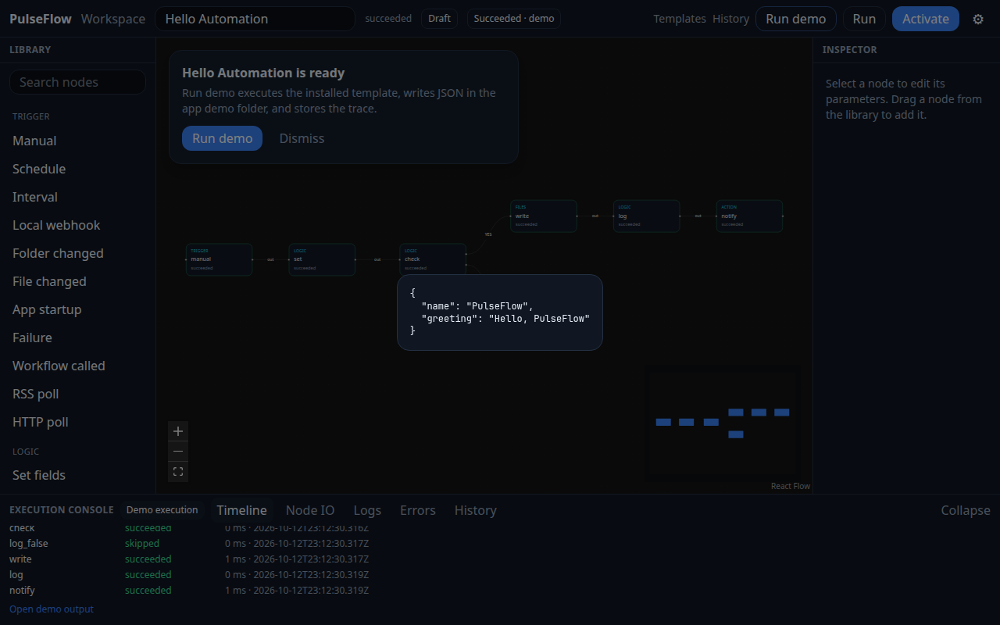

# PulseFlow

PulseFlow is a free, open-source, local-first workflow studio from ZeroPulse. You can edit a graph, run it on your machine, and read the execution trace without an account, a subscription, or a cloud project.

It is an independent implementation. It does not include source, artwork, or templates from n8n, Zapier, Make, Power Automate, or Node-RED.

## Run it

Requirements: Node.js 22.14 or newer (22.22 or newer is preferred) and pnpm 10.

```bash
pnpm install
pnpm dev
```

Open http://127.0.0.1:5173. The first screen is Hello Automation. **Run demo** executes the workflow and writes `hello-automation.json` under the demo folder in `PULSEFLOW_HOME` (default `./.pulseflow/demo`).



Other commands:

```bash
pnpm test
pnpm test:templates
pnpm pulseflow doctor
pnpm pulseflow run wf_a01
```

## What is real

- Twenty-four installed templates. Tier A runs offline. Tier B has a **Try demo** path against a loopback fixture. **Run live** stays disabled until a credential of the required kind is stored.
- The engine, the API, and the CLI share one executor. History is SQLite.
- Secrets are encrypted with a local key file. API credential lists do not return the secret.

## What is not claimed

- `pnpm package:win` writes an unsigned Windows x64 zip to `apps/desktop/release/PulseFlow-0.1.0-win.zip`. This environment built that zip and launched the same main bundle under Linux Electron. The Windows `.exe` was not started here. The NSIS installer is produced by the Windows CI job; Wine is required to build it on Linux. SmartScreen stays enabled.
- Live GitHub, Discord, SMTP, Telegram, and spreadsheet calls need your own credentials and are subject to those providers' terms and prices.
- There is no multi-user RBAC product yet. The database has tables for a later server mode.

License: Apache-2.0. See `docs/FEATURE_MATRIX.md` for status, and `docs/DEVELOPMENT.md` for setup notes.
